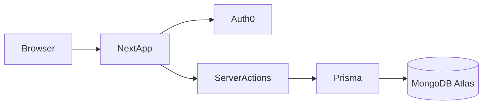

# PocketMoney MVP Implementation Plan

## Locked tech stack

| Layer | Choice |
|-------|--------|
| App | **Latest Next.js** via `create-next-app@latest` (App Router) + TypeScript + Turbopack |
| UI | Tailwind CSS + shadcn/ui + CSS-variable theming (`next-themes` light default; kid-friendly palette, not purple/cream AI defaults) |
| Auth | Auth0 via `@auth0/nextjs-auth0` v4 (email/password + Google) |
| Data | MongoDB Atlas + **Prisma 8 Mongo** (`@prisma/orm-mongo`, same pattern as Lesson47/ecom) |
| Hosting | Vercel |
| Validation | Zod (shared client/server) |
| Money | Integer cents; display as `€X.XX` |

**Defaults from PRD open questions:** hard-delete transactions; weekly summary always independent of list filters; Auth0 Database connection + Google social.

**Project location:** [`Lesson48/`](Lesson48/) — Next.js app root is the lesson folder itself (keep existing `PRD.md` and `notes.md`).

---

## Architecture



- **Auth0** (`@auth0/nextjs-auth0` v4) mounts `/auth/login`, `/auth/logout`, `/auth/callback` via the SDK request handler (`proxy.ts` on current Next.js / Auth0 quickstart, or `middleware.ts` if that is what the installed SDK docs require).
- Protected app routes (`/home`, `/transactions/*`) require a session; unauthenticated users only see landing → login.
- **Server Actions** for create/update/delete/list (Node runtime, Prisma singleton). No separate API service.
- Scope every query by Auth0 `sub` (`userId`).

---

## Data model (Prisma 8 Mongo — Lesson47/ecom pattern)

Use `@prisma/orm-mongo` + `prisma` RC + `@prisma/cli-engine`, with:

- [`prisma.config.ts`](Lesson48/pocket-money/prisma.config.ts)
- [`src/prisma/contract.prisma`](Lesson48/pocket-money/src/prisma/contract.prisma)
- [`src/prisma/db.ts`](Lesson48/pocket-money/src/prisma/db.ts) → `db.orm.*`
- `npx prisma contract emit` after contract changes

```prisma
enum TransactionType { income expense }
enum Category { Allowance Gifts Food Games Savings }

model User {
  id           ObjectId @id @map("_id")
  auth0_id     String   @unique
  createdAt    Date
  updatedAt    Date
  transactions Transaction[]
  @@map("users")
}

model Transaction {
  id          ObjectId        @id @map("_id")
  userId      ObjectId
  user        User            @relation(fields: [userId], references: [id])
  type        TransactionType
  amountCents Int32
  category    Category
  occurredAt  Date
  createdAt   Date
  updatedAt   Date
  @@map("transactions")
}
```

On Auth0 callback / first authenticated request: upsert `User` by `auth0_id`. Transactions reference local `User._id`. Query with `db.orm.users` / `db.orm.transactions` (same API as ecom).

---

## Routes and screens

| Route | Purpose |
|-------|---------|
| `/` | Landing + Log in / Sign up CTAs → `/auth/login` |
| `/home` | Balance, this-week summary, list, Add CTA, Filters, Log out |
| `/transactions/new` | Add form (type, amount, category, date/time; default now) |
| `/transactions/[id]/edit` | Edit form |
| Delete | Confirm dialog (shadcn `AlertDialog`) on home/edit — not a route |

**Filters:** collapsible section or sheet on `/home` — optional `from` / `to` / `category`; Apply / Clear. Balance and week summary stay unfiltered.

---

## Core logic

- **Balance:** `sum(income) − sum(expense)` over all user transactions (cents → EUR display).
- **This week:** Monday 00:00:00 – Sunday 23:59:59.999 in the user’s local timezone. Client computes week bounds as ISO strings; server aggregates with those bounds (or accept `timezone` offset once and compute server-side — prefer client-sent `weekStart`/`weekEnd` ISO for MVP simplicity).
- **List:** `occurredAt` desc; optional date range + category filter.
- **Validation:** amount &gt; 0, max 2 decimal places (convert to cents), required type/category/`occurredAt`; future dates allowed.
- **Empty state:** friendly copy + Add CTA; balance/week show `€0.00`.

---

## UI / theming

- Scaffold shadcn (Button, Input, Label, Select, Dialog/AlertDialog, Sheet, Card sparingly only for interactive form containers if needed).
- Plain language: “Money in” / “Money out”; large tap targets; distinct income vs expense color tokens via CSS variables.
- Minimal chrome: one composition on home (balance → week → list → Add).

---

## Env and deploy

**Local `.env.local` + Vercel env:**

- `DATABASE_URL` (Atlas SRV)
- `AUTH0_DOMAIN`, `AUTH0_CLIENT_ID`, `AUTH0_CLIENT_SECRET`, `AUTH0_SECRET`, `APP_BASE_URL`

Auth0 app: Regular Web Application; callbacks `http://localhost:3000/auth/callback` and production URL; same for logout URLs; enable Database + Google.

Vercel: connect repo, set env vars, deploy. Prisma runs on Node serverless functions (not Edge).

---

## Implementation phases

1. **Scaffold** — From [`Lesson48/`](Lesson48/), run `npx create-next-app@latest .` with latest defaults (TypeScript, App Router, Tailwind, ESLint, `src/`, `@/*`, Turbopack). Use `--disable-git` so we do not nest a new git repo. Preserve `PRD.md` and `notes.md`. Then shadcn init + theme tokens; add `components/`, `lib/`, `actions/`, `prisma/`.
2. **Auth** — Auth0 client + SDK request handler; landing; protect `/home` and transaction routes; logout.
3. **Database** — Atlas `DATABASE_URL`, Prisma 8 Mongo contract + `db.ts` (ecom pattern), `contract emit`, user upsert helper.
4. **Transactions CRUD** — Zod schemas, server actions, add/edit pages, delete confirm, list query with filters.
5. **Home aggregates** — balance + weekly summary + empty states; EUR formatting util.
6. **Polish + ship** — kid-friendly copy/theming, loading/error states, Vercel deploy checklist, README with Auth0/Atlas setup.

**Scaffold command (concrete):**

```bash
cd Lesson48
npx create-next-app@latest . --typescript --tailwind --eslint --app --src-dir --import-alias "@/*" --turbopack --disable-git --yes
```

Pin whatever version `create-next-app@latest` installs at scaffold time (currently Next.js 16.x).

---

## Key files to create

- [`Lesson48/pocket-money/prisma.config.ts`](Lesson48/pocket-money/prisma.config.ts)
- [`Lesson48/pocket-money/src/prisma/contract.prisma`](Lesson48/pocket-money/src/prisma/contract.prisma)
- [`Lesson48/pocket-money/src/prisma/db.ts`](Lesson48/pocket-money/src/prisma/db.ts)
- [`Lesson48/pocket-money/src/lib/auth0.ts`](Lesson48/pocket-money/src/lib/auth0.ts)
- [`Lesson48/pocket-money/src/lib/users.ts`](Lesson48/pocket-money/src/lib/users.ts)
- [`Lesson48/pocket-money/src/lib/money.ts`](Lesson48/pocket-money/src/lib/money.ts)
- [`Lesson48/pocket-money/src/actions/transactions.ts`](Lesson48/pocket-money/src/actions/transactions.ts)
- [`Lesson48/pocket-money/src/app/home/page.tsx`](Lesson48/pocket-money/src/app/home/page.tsx)
- [`Lesson48/pocket-money/src/proxy.ts`](Lesson48/pocket-money/src/proxy.ts)

---

## Out of scope (per PRD)

Budgets, charts, bank sync, parent sharing, custom categories, multi-currency, i18n, soft-delete.